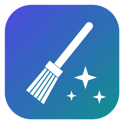

<p align="center">
  
</p>

<h1 align="center">ByteBroom</h1>

<p align="center">
  See which caches are eating your disk on Windows, and clear them safely in one click.
</p>

---

Developer tools and apps keep huge download caches: uv and pip packages, npm, Docker images,
Hugging Face and Whisper models, browser caches, and more. They are spread across
`AppData`, `.cache` and other folders, and they quietly grow to tens of gigabytes.

ByteBroom finds them, shows their size, and clears the ones you tick. It doesn't touch anything else.

<!-- Add a screenshot: docs/screenshot.png -->

## Features

- **One list for every cache.** Each row shows the size and a note on what happens when you clear it.
- **Safe by default.** Caches that just re-download are pre-ticked. Anything where you lose
  something (big AI models, Docker data) is marked **CAUTION** and left unticked.
- **Uses official commands where they exist.** It runs `uv cache clean` and `docker system prune`
  instead of deleting those tools' files directly.
- **Reports real results.** "Freed" is measured as the change in free disk space.
- **Light and dark theme.** A single `.exe` with nothing to install.

## What it cleans

| Safe (pre-ticked) | Caution (not ticked) |
|---|---|
| uv, pip, npm and Yarn package caches | OmniVoice / Hugging Face / Whisper / PyTorch models |
| Windows Temp (files older than 1 day) | Chrome on-device AI model (Gemini Nano) |
| Chrome, Chrome Beta and Edge web cache (not your profile) | Playwright browsers |
| Discord cache, GPU shader cache, crash dumps | Flutter/Dart pub cache, Gradle caches |
| Arduino downloads, Ollama installers, Nuitka and Selenium caches | Docker unused data (`docker system prune`) |

Only caches that exist on your PC are shown. The full list is in
[`src/bytebroom/caches.py`](src/bytebroom/caches.py).

## Safety

- Symlinks and junctions are **never followed**. A link is removed, but its target is untouched.
- For a cache folder, only its **contents** are deleted and the folder itself is kept.
- Your home folder, `AppData`, `AppData\Local\Programs` and drive roots are refused.
- Files in use are skipped, never forced. Close the app (for example Chrome) and clear again.
- Files are deleted **permanently**, not moved to the Recycle Bin.

## Download

Get `ByteBroom.exe` from the [Releases](../../releases) page and run it.

The exe is not code-signed, so Windows SmartScreen may warn you the first time.
Click *More info* and then *Run anyway*, or build it yourself (see below).

## Run from source

```bash
git clone <this repo>
cd bytebroom
pip install -e .
bytebroom            # or: python -m bytebroom
```

Requires Python 3.9+ on Windows.

## Build the .exe

```bash
pip install -e ".[dev]"
python scripts/build_exe.py      # creates dist/ByteBroom.exe
```

Pushing a tag like `v0.1.0` makes GitHub Actions build the exe and attach it to a release.

## Add a cache

Each cache is one entry in [`src/bytebroom/caches.py`](src/bytebroom/caches.py):

```python
Cache("cargo", "Cargo registry", (P(HOME, ".cargo", "registry", "cache"),), True,
      "Rust crate downloads. Re-downloaded on next build."),
```

- `safe=True` means it only re-downloads. Use `False` if the user loses something.
- `command=("tool", "clean")` runs the tool's own clean command first.
- `min_age_hours=24` deletes only older files. `close_first="App"` reminds the user to close an app first.

Run `pytest` before opening a pull request.

## License

[MIT](LICENSE)
